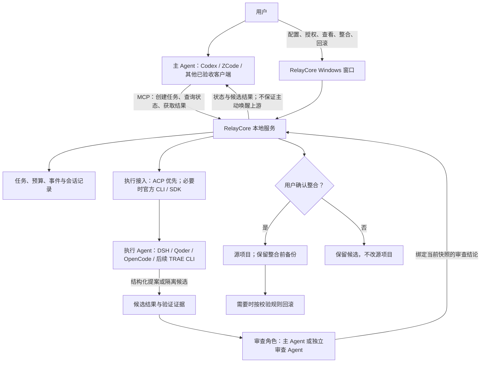
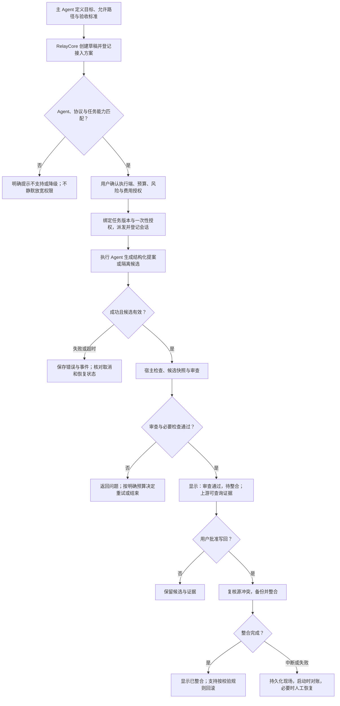

# RelayCore Windows 桌面版与多 Agent 接入计划书

日期：2026-11-08  
性质：产品与技术规划，不代表已经实现或通过兼容性验收。  
起点：本地仓库已有 `v1.0.0` tag，当前检查的提交为 `f157d50`；本计划不改产品源码。  
目标：从目前的 Codex＋DSH 工作流，逐步发展为可下载安装的 Windows 本地 Agent 协作工具。

## 一、判断与定位

**可以做成 Windows 软件，也具备扩展其他 Agent 的基础，但不能把这两件事视为“打包一次就完成”。**

Windows 安装版解决用户需要打开终端、安装运行环境、手填路径等使用成本；多 Agent 接入解决不同软件之间的任务分工。前者主要是交付与进程管理工作，后者涉及协议适配、权限、结果验证和恢复语义。

建议定位：

> RelayCore 是 Windows 本地的 Agent 任务协作与验收工具。用户继续使用自己喜欢的主 Agent，通过 RelayCore 将有明确边界的任务交给执行 Agent，并查看过程、检查结果、决定是否写回项目。

首版桌面化不重新造一个聊天机器人或代码编辑器，不承诺支持所有 Agent，也不把“软件互相对话”本身作为主要价值。

### 1. 模型、Agent 软件和分工应分开

“GPT 是主力、DSH 干小活”可以描述当前使用方式，但技术上应区分：

- GPT 是模型系列；在当前项目中，承载规划和工具调用的是 Codex 等 Agent 软件。
- DSH、Qoder、OpenCode、TRAE 等是带上下文、工具、权限与会话管理的 Agent 软件，不只是一个模型接口。
- 主 Agent 与执行 Agent 是某次任务中的角色，不应永久绑定某个品牌，也不保证执行 Agent 一定更便宜或能力更弱。
- 审查者是第三个逻辑角色。它可以由主 Agent承担，也可以是单独配置的审查 Agent；不能因执行 Agent声称完成，就自动批准整合。

用户可以选择“ZCode 规划、Qoder 执行”，但这不意味着 ZCode 自动获得 Qoder 的全部内部功能，也不意味着双方共享登录、记忆或订阅额度。

### 2. 本轮最值得验证的价值

优先验证跨软件的可控委派：主 Agent 已理解项目，将边界清晰的任务交出去，RelayCore 保留授权、候选、审查、整合和撤销记录。

“省钱”只能作为待验证收益。总成本包含主 Agent 分解、上下文整理、执行、审查、重试和用户等待；简单改一个文件时，多 Agent 的开销可能更高。需要实际比较任务总消耗、人工干预次数和通过率，不能预先承诺节省百分比。

## 二、现有基础与真实缺口

### 已有、可以保留的部分

- `src/mcp.mjs` 已向外提供创建、查询、派发、暂停、恢复、停止、引导等工具，主 Agent 接入不必重新设计一套入口。
- 本地服务已具备任务持久化、授权、预算、事件、候选工作区、独立审查、整合与回滚机制。
- 现有网页控制台可作为 Windows 桌面窗口的界面基础。
- DSH 已经通过 ACP 接入，证明项目具备管理外部 Agent 会话的起点。

### 不能用配置改名代替的缺口

- `src/dsh.mjs` 的默认执行与审查仍组合为 DSH 提案、Codex 审查。
- `src/core.mjs` 中会话、回合及记账入口仍存在 `dsh`／`codex` 名称约束。
- DSH 启动路径、账户环境、事件处理和会话显示有专用逻辑，不能直接套在 Qoder 或 OpenCode 上。
- 当前运行时要求 Node.js 24.15.0 及以上的 24.x，并依赖 SDK 的平台可执行文件。打包必须处理这些资源。
- 当前项目运行数据位于项目下 `.RelayCore`；安装目录、项目目录、用户配置和凭据目录需要明确分工。
- 已有 Release 和 tag 不等于已经有经过安装、升级、卸载验收的 Windows 安装包；本轮没有发现已跟踪的 Electron／Tauri 打包工程。

前一份发布审查报告是当时版本的证据，不自动代表 `v1.0.0` 中的问题仍未修复；本计划不把历史问题直接判成当前缺陷。桌面化前应针对实际 Release 复核关键回归。

## 三、目标架构

推荐将 RelayCore 保持为中间协调者：上游接收任务，下游执行任务，中间负责权限、状态与结果证据。

独立图文件：[多Agent协作架构](多Agent协作架构-2026-11-08.mmd)。

### 1. 主 Agent 接入：优先复用 MCP

主 Agent 负责理解目标、决定是否委派、定义允许路径和验收标准、读取结果。RelayCore 提供工具，不负责接管对方整个聊天窗口。

支持 MCP 的软件可以成为接入候选，但还需要验证协议版本、工具权限、超时和实际行为。不能直接把“官方支持 MCP”写成“已经兼容 RelayCore”。

任务应异步派发，尽快返回任务 ID。主 Agent 后续通过查询读取进度与结果。**MCP 接通不等于能主动唤醒任意主 Agent 聊天窗口**；没有官方通知／会话恢复能力时，先采用轮询或用户主动查询。

### 2. 执行 Agent 接入：优先 ACP，其次官方 CLI／SDK

执行端必须让 RelayCore 能可靠启动任务、识别会话、知道是否结束，并处理权限和取消。普通 MCP 工具调用能力不能单独证明这些条件成立。

接入优先级：公开 ACP 服务端 → 官方无交互 CLI／SDK → 官方任务 API。仅有图形界面的产品不纳入首批自动执行承诺，不以模拟鼠标键盘作为正式接入基础。

即使双方都说支持 ACP，权限请求、文件操作、终端操作、会话恢复和取消行为仍可能不同。应做能力协商与实测，而不是强行用同一套默认权限处理所有产品。

### 3. 审查角色单独配置

建议先保留当前 Codex 审查路线，先验证上游、执行端的可替换性。之后再支持主 Agent 审查或其他审查器。

如果让主 Agent审查，需要另行定义返回审查结论的受控入口：结论绑定任务版本、候选 hash 和审查快照；上游不能通过一段普通引导文字完成授权或整合。该入口是规划内容，不能假定现有 MCP 已经具备。

无论谁审查，保留宿主确定性检查与用户整合决定。模型的审查批准，不代替文件冲突检查，也不代替用户授权。

## 四、候选产品的接入评估

以下根据 2026-11-08 查阅的官方文档。表中的“有接口”仅表示具备实现依据，**本次未安装这些软件进行 RelayCore 联调**。国际版、国内版、企业版和 CLI 的能力不能混用。

| 产品 | 作为主 Agent | 作为执行 Agent | 建议 |
|---|---|---|---|
| Codex＋DSH | 已有项目使用路径 | DSH 已有项目使用路径 | 保留为基准组合，避免扩展时破坏原流程 |
| ZCode | 官方说明支持 stdio／HTTP／SSE MCP | 本次未核实其可用于该目标的受控执行接口 | 先验证为上游；这里按智谱 ZCode 理解 |
| Qoder | 官方 CLI 支持 MCP | 官方提供 `qoder --acp`，Windows 有支持范围说明 | 适合首个新增执行端，固定 CLI 版本和架构验收 |
| OpenCode | 官方支持本地和远程 MCP | 官方提供 `opencode acp` | 适合作为第二个执行端，检验是否真正摆脱 DSH 专用假设 |
| TRAE | 官方提供本地 MCP 配置 | TRAE CLI 官方提供 ACP；CLI 2.0 文档包含 Windows | 后续候选；要区分 IDE、SOLO、CLI 和地区版本 |
| WorkBuddy | 官方开放平台提供 MCP 连接器接入 | 本次没有确认相同桌面产品的受控执行接口 | 先考虑上游；不能以 CodeBuddy CLI 文档替代 WorkBuddy 桌面能力证明 |

官方依据：

- [ZCode MCP](https://zcode.z.ai/en/docs/mcp-services)
- [Qoder MCP](https://docs.qoder.com/cli/mcp-servers)、[Qoder ACP](https://docs.qoder.com/cli/acp)
- [OpenCode MCP](https://docs.opencode.ai/docs/mcp-servers/)、[OpenCode ACP](https://docs.opencode.ai/docs/acp/)
- [TRAE MCP](https://docs.trae.cn/ide_add-mcp-servers)、[TRAE CLI ACP](https://docs.trae.cn/cli_agent-client-protocol)、[TRAE CLI Windows 说明](https://docs.trae.cn/cli_get-started-with-trae-cli-2?lang=zh)
- [WorkBuddy 官方连接器](https://open.workbuddy.cn/docs/connector)

所以，“ZCode 为主、Qoder 为下游”是有公开接口支撑的可行组合；当前只能判定**值得做兼容性验证**，不能宣布已支持。

## 五、Windows 软件方案

### 1. 用户应得到什么

用户下载 `RelayCore-Setup-x64.exe` 一类安装包，安装后从开始菜单启动。窗口中选择项目、检测 Agent、完成各自登录与接入配置、设置预算、批准任务并查看结果。该文件名是建议，不是已有产物。

用户不必自行安装 Node、运行 `npm ci` 或保持 PowerShell 窗口；但第三方 Agent 仍可能需要用户分别安装和登录。不要把“RelayCore 无需配置开发环境”宣传成“所有 Agent 和账号都自动准备好了”。

安装包是一个 EXE，不要求内部只有一个二进制文件。安装后的运行时、SDK 可执行文件、资源和配置分开存放更易维护。

### 2. 推荐技术路线

**优先评估 Electron 薄壳，保留 Node 后端与现有网页界面。** 原因是现有工程以 JavaScript／Node 为主，复用成本更直接。窗口负责显示与本地操作，后台进程负责调度，Agent 各自作为受控子进程运行。

不要默认 Electron 自带的 Node 版本必然满足当前 `node:sqlite` 等要求：先做运行时兼容验证；若不满足，随安装包携带已验证的 Node 24 运行时并独立启动当前服务。成本是安装体积和依赖分发，而不是业务逻辑重写。

Tauri 也是可行备选，官方提供 Node sidecar 路线以及 Windows EXE／MSI 安装包能力；但仍需携带 Node／资源，增加 Rust 构建和 sidecar 管理工作。不建议为了缩小界面壳而重写当前核心。完成最小打包验证后再确定框架，不先报未经测量的包体积。

参考：[Electron 后台进程能力](https://www.electronjs.org/docs/latest/api/utility-process)、[Tauri Node sidecar](https://tauri.app/learn/sidecar-nodejs/)、[Tauri Windows 安装包](https://tauri.app/distribute/windows-installer/)。

### 3. 打包之外必须完成的工作

| 工作 | 必须解决的问题 |
|---|---|
| 运行时与资源 | Node、SDK 的 Windows 原生程序和依赖可定位；不能依赖开发机目录 |
| 目录分工 | 安装目录只放程序；用户配置／凭据放用户数据位置；项目候选和备份归属项目 |
| 多项目行为 | 初版可只支持一个活动项目；必须明确切换规则、端口与进程归属，避免多个窗口争抢默认端口 |
| 进程生命周期 | 单实例、后台异常退出、暂停任务、关闭窗口与退出程序的区别；退出不盲目终止用户其他软件 |
| 登录与配置 | 用户自行授权第三方账户；检测路径和版本；生成可预览的 MCP 配置，修改前备份且不覆盖无关项 |
| 界面安全 | 窗口仅展示可信本地界面；不因用了桌面壳就取消现有授权；网页内容不直接取得任意本机执行权限 |
| 安装与升级 | Windows 签名、包完整性校验、数据库迁移、失败恢复；更新不覆盖用户项目和运行数据 |
| 卸载 | 清楚区分删程序与删用户数据；未完成任务和备份不能被默认清空 |
| 排障 | 一键自检与脱敏诊断；不让用户提交整个账号目录或原始会话 |

不要默认把 DSH、Qoder、Codex 等第三方安装包和登录材料一起打进 RelayCore。先按用户已安装的软件接入；若以后代安装或分发，逐项核对官方许可、安装方式与账号授权范围。

## 六、统一任务流程

独立图文件：[任务执行与验收流程](任务执行与验收流程-2026-11-08.mmd)。

暂停、恢复和停止不是所有 Agent 的共同保证。适配器必须声明：是否真正支持继续原会话，是否只能重新执行，取消能确认到哪一步。不能把“不再接收结果”展示为“远端已停止且不再收费”。

## 七、最小技术改造范围

### 1. 先改清角色与接入身份

任务中区分主 Agent、执行 Agent、审查 Agent 的身份、版本与会话 ID；任务执行时固定这份配置，不能中途切换供应方后继续沿用原授权。

预算统计要区分外部提示次数、软件内部模型循环、token 和真实费用。只有某个接入端明确提供的数据才展示为已计量，不能把所有品牌的 usage 字段直接相加。

### 2. 两种执行范围明确分开

- **受控提案：** 给执行端有限输入，返回结构化候选，由 RelayCore 检查和落盘。最接近目前已走通的路线，首批优先。
- **可操作工作区：** Agent 在隔离候选环境中读写并运行工具。需要额外处理文件、终端、网络、权限请求和取消，不应随更换 ACP 程序自动开放。

如果 Qoder 的某项 ACP 功能依赖客户端提供文件系统或终端服务，而 RelayCore 尚未实现，界面应明确显示“不支持此能力”，而不是启用 bypass 模式绕过它。

### 3. 不先建设复杂插件系统

先让 DSH 与一个新增执行端共用明确的任务输入、状态、结果和错误格式。通过第二个产品的实际差异识别哪些逻辑可复用，再抽出最少的共享部分。

首轮不做插件市场、热加载、任意脚本适配器、多层 Agent 自由转派、自动跨账号重试或并发 Agent 团队。这些会扩大授权和排障范围，尚不能证明是当前用户需要的。

## 八、分阶段实施与准入

| 阶段 | 交付 | 完成标准 |
|---|---|---|
| A：桌面打包验证 | 最小 Windows 窗口、内置运行时、现有后端 | 干净 Windows 机器无 Node 环境能启动；原有路径可用；安装目录不写运行数据 |
| B：首个可用安装版 | 项目选择、登录引导、自检、任务状态、整合／回滚 | 新用户照界面完成当前 Codex＋DSH 流程；关闭、崩溃、重开不丢状态；升级保留数据 |
| C：先扩上游 | ZCode → RelayCore → DSH | 创建、授权、派发、查询、取消和结果读取闭环通过；主 Agent 不必是 Codex；此时可暂保留 Codex 独立审查 |
| D：再扩执行端 | ZCode → RelayCore → Qoder CLI | 使用公开接口完成同类受控任务；权限与预算不弱化；原组合全部回归通过 |
| E：验证通用性 | 增加 OpenCode，再评估 TRAE CLI | 不再依赖 DSH 事件格式；形成按版本、系统、角色与能力区分的兼容矩阵 |
| F：按需求扩展 | WorkBuddy 上游或其他产品；更完整工作区执行 | 有明确用户需求、官方接口和维护能力，再进入实现 |

A 与接口小样验证可以交错进行，但不要同时上线五个未验证适配器。优先验证一组非 Codex 主 Agent和非 DSH 执行端，才足以证明产品方向，而不是只证明品牌配置项变多了。

阶段不预估具体天数：当前仍缺 Windows 打包试验、目标软件实际版本、登录方式和权限联调结果，直接报工期会掩盖主要不确定性。

## 九、每个新增接入端的验收清单

- 官方协议入口、Windows 架构、具体版本和登录方式已登记，不能只写产品名。
- 创建会话、发送任务、接收过程、识别完成和解析错误可重复验证。
- 权限请求可处理或明确拒绝；没有为了兼容而默认全权限运行。
- 停止／超时／断线／重启／登录失效／额度不足均有准确状态。
- 候选验证、源文件冲突、审查绑定、整合与回滚不依赖执行端自报成功。
- 主 Agent可读结果与证据，但不能以普通引导绕过用户授权。
- 日志可归属到具体任务与会话，导出经过脱敏。
- 不支持的恢复、usage、结构化输出等能力如实展示。
- 升级后重新验证兼容矩阵；不因都支持 ACP 就推断所有版本永远兼容。

## 十、结论与下一步选择

建议推进，优先级是：**先让现有流程成为好安装、好配置、可恢复的 Windows 软件，再用 ZCode＋Qoder 验证跨品牌协作，随后扩展 OpenCode 与 TRAE CLI。**

产品承诺应收敛为“已验证组合的可靠委派、可见过程与可撤销交付”。MCP 和 ACP 提供接入基础，可靠性仍来自 RelayCore 对任务、权限、候选、审查和源文件的管理。

本次仅写入计划书与流程图；没有创建安装工程、修改源码、改第三方配置、安装 Agent 或执行付费任务。
